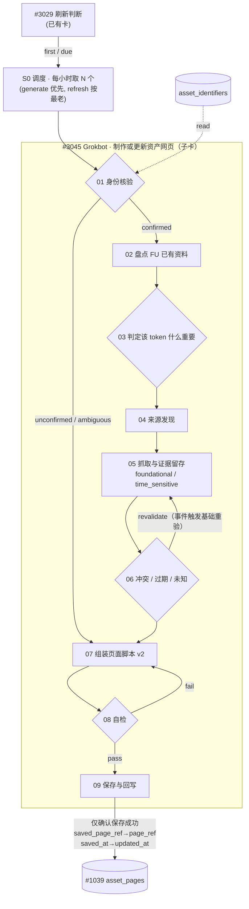

# 资产研究流程 · SignalStudio 风格子卡草案（v0，DRAFT）

> 草案，未安装、未批准。卡片编号 `DRAFT-3045-xx` 是占位，不对应 SignalStudio 的真实编号。SignalStudio 仓库没有改动（本地 clone 停在 1da17af，`git status` 为空）。

- 机器可读：`asset-research-cards.draft.v0.json`（由 `build_cards.py` 生成）
- 格式参考：`catalog/asset-grokbot-flow.v1.json`（cards / fields / output_fields / connections / branches / write_guard）、`catalog/polars-indicator-module.v1.json`（parent + 编号子卡，“编号不代表独立程序”）、`catalog/card-model.v1.json`（kind：process / decision / table；profile；trigger）
- 每张卡在 JSON 里都写了：目的（description_zh）、输入/输出（fields、output_fields）、决策规则（decision_rules_zh）、来源/工具（sources_tools）、失败模式（failure_modes_zh），以及来自 2026-10-18 真实试运行的证据（trial_evidence，附文件路径）

## 流程图

## 卡片一览

| 编号（占位） | 名称 | 类型 | 核心规则 | 试运行证据（摘要） |
|---|---|---|---|---|
| DRAFT-3045-S0 | 调度 · 每小时小批量取待办 | process / schedule | generate 优先，refresh 按最老优先；N=2 占位；同一资产加租约；失败保留旧记录 | 单 token ≈ 4 分钟、9 次免费 HTTP + 3 次工具调用；网络只占 3–11 s |
| DRAFT-3045-01 | 身份核验 | decision | 不按 ticker 识别；至少两个独立来源一致才算 confirmed | BONK mint 经链上 RPC 供应核对；SOL 为原生资产；FU 映射未核对 |
| DRAFT-3045-02 | 盘点 FU 已有资料 | process | 字段存在 ≠ 已采集；时效类不复用 | 无 FU 访问 → heat 版块 omitted |
| DRAFT-3045-03 | 判定该 token 什么重要 | decision | 按类型 + 重大事件定版块顺序 | BONK 治理攻击把 events/risks 提到 market 前面 |
| DRAFT-3045-04 | 来源发现 | process | 一手 > API > 二手 > AI 汇总 | 6/15 次工具调用；Binance 451 → 换官方镜像 |
| DRAFT-3045-05 | 抓取与证据留存 | process | 每个来源记 url / retrieved_at / published_at / sha256 / freshness | 18 次 HTTP，全部有证据记录 |
| DRAFT-3045-06 | 冲突 / 过期 / 未知 | decision | 不估算；链上优先；冲突并列；事件可让基础资料提前过期 | BONK 最大供应冲突；SOL 的 PoH 描述被 Alpenglow 打成即将过期 |
| DRAFT-3045-07 | 组装页面脚本 | process | 数值由程序从证据读出；三个时间分开 | 每页 12 块；生成时间改成真实值 |
| DRAFT-3045-08 | 自检 | decision | 用前端同一解析器，skipped 必须为 0 | 抓出 tone=warn 非法值导致跳块，已修正 |
| DRAFT-3045-09 | 保存与回写 #1039 | process | 沿用现有 write_guard | 未真实保存（status=unconnected） |

## 和现有 SignalStudio 卡的关系
- `#3029 刷新判断` 和 `#1039 asset_pages` 保持不变；新增的调度卡 S0 放在两者之间，读 FU 待办接口（契约 C7，未实现）。
- 子卡全部挂在 `#3045` 名下（父卡写法参照 polars 模块），`#3045` 对外的输入输出字段和写回守卫不变。
- 占位值（N、整页周期、foundational 重验天数、冲突阈值、重试上限）都放在 JSON 的 `placeholders`，没有定值。
