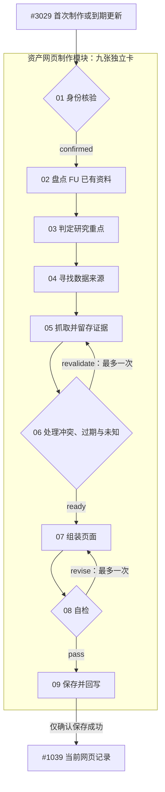

# 资产网页制作：九张独立草稿卡

本目录交付九张可独立阅读的步骤卡及其字段、连接和失败分支，供后续代理评审。修订依据：[SS-123](https://app.notion.com/p/3fe038a63d5a8139b371d883df2fd1af)。用户于 2026-10-19 批准修复本 PR 为九卡；这不批准安装正式图卡、合并 main、真实调用或部署。

## 入口与文件

- **先读本文件，再读 `agent-flow-v0.1.md` 和 JSON。**
- `asset-research-cards.draft.v0.json`：九张卡的完整定义；保留原文件名便于已有代理定位，内部版本为 `asset-research-cards.draft.v0.1`。
- `build_cards.py`：唯一生成源，只使用 Python 标准库；生成 JSON 并检查字段链路、分支和文件一致性。
- `agent-flow-v0.1.md`：本批九卡设计的精确行为与接入限制；与 JSON 同一版本。

所有卡仍是草稿，占位编号 DRAFT-3045-01 至 09，不是正式 Studio 编号。模块入口是导航容器，不计作第十张处理卡。原调度 S0 已移出 `cards`；每小时、N=2、队列优先级、租约和退避均为未启用的后续提议，无运行默认值。

## 模块内的九张卡

| 占位编号 | 名称 | 可检查的结果 |
| --- | --- | --- |
| DRAFT-3045-01 | 身份核验 | 同一 UUID 的 FU 映射与外部核查；不确认即停止 |
| DRAFT-3045-02 | 盘点 FU 已有资料 | 合格证据与缺口，区分未知和读取失败 |
| DRAFT-3045-03 | 判定研究重点 | 有证据支持的初步版块计划 |
| DRAFT-3045-04 | 寻找数据来源 | 针对缺口的来源与授权预算 |
| DRAFT-3045-05 | 抓取并留存证据 | 可被后卡读取的证据值、出处与时间 |
| DRAFT-3045-06 | 处理冲突、过期与未知 | 可用事实、未决冲突、未知及计划修订 |
| DRAFT-3045-07 | 组装页面 | 复用 FU 前端的页面产物与事实引用 |
| DRAFT-3045-08 | 自检 | 同版本解析器与内容检查报告，保留产物 |
| DRAFT-3045-09 | 保存并回写 | 同资产、同运行的确认成功回执 |



图中省略各卡的终止分支；完整分支见 JSON。身份未确认、阻断冲突、未接入或失败均结束本次任务并保留旧成功页，不能转而保存“身份未确认页”。两个返回分支与继续分支互斥。

## 证据与运行边界

本次完成的是设计修正和静态检查。FU 读取、证据存储、前端产物/解析器、保存与回写适配器均未接通。本 PR **不会让工作台自动显示九卡**；正式安装需要模块归属、编号分配、原 #3045 身份/连接迁移、共享组件展示和相关验收。

每卡的 `trial_evidence` 保留原作者报告，统一标记 `author_report_unverified`。`files` 是相对原环境 `/workspace/asset-page-research/` 的位置；日志、截图、页面样本和测试没有随 PR 提供，也没有可核验的固定外部链接。约4分钟、252项测试通过及具体行情/事件描述都不能当作本批已验证事实。原始十卡版本保存在 [52873ec](https://github.com/lkyxuan/SignalStudio/commit/52873ec358e1619d91abd7de54cd7a37a9648d49)。

## 生成与验证

从仓库根目录执行：

```sh
python3 docs/drafts/asset-research-cards/build_cards.py
python3 docs/drafts/asset-research-cards/build_cards.py --check
```

脚本根据自身路径写入同目录，不依赖当前目录。检查九卡与模块归属、输出字段声明、连接所需输入、终止分支无出边、成功保存守卫、有限返回次数以及 JSON 与生成源一致。它不执行后端、网络调用或网页解析器，不验证原作者的试跑报告。
